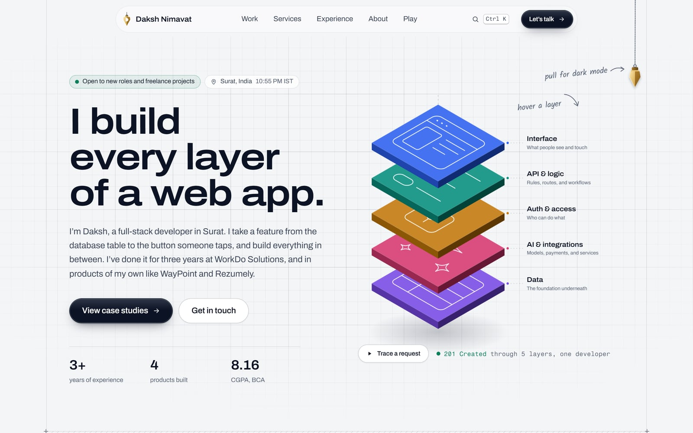
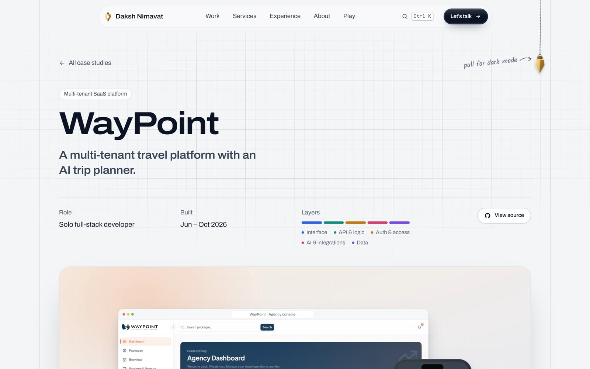
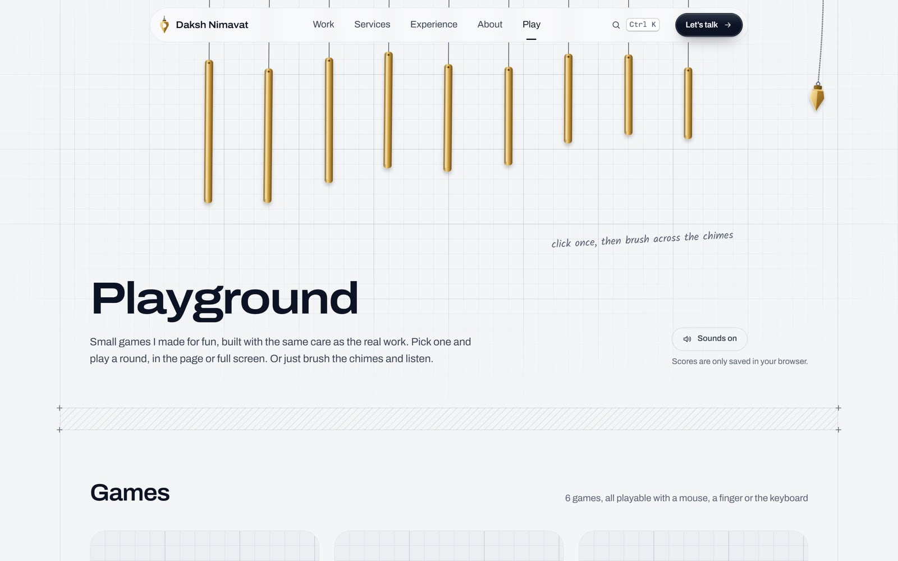
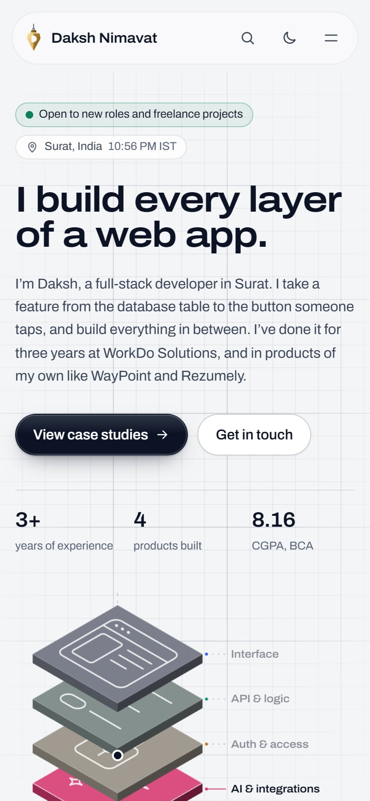

<div align="center">

# Daksh Nimavat

**Full-stack developer in Surat, India.** This is the code for my portfolio.

[**daksh-nimavat.vercel.app**](https://daksh-nimavat.vercel.app)


</div>

<picture>
  <source media="(prefers-color-scheme: dark)" srcset="docs/readme/home-dark.jpg" />
  
</picture>

I’m a web developer at WorkDo Solutions, where I work on SaaS, ERP and booking products. In my own time I build complete apps, from the database up to the screens. This site is where I write those apps up properly, so you can see how they work and why I built them that way.

## What’s on the site

**Home.** The hero is an isometric stack of the five layers every product I build has: interface, API and logic, auth and access, AI and integrations, and data. Hover a layer to lift it, or press *Trace a request* to follow one booking down through every layer and back. Below that are my case studies, the services I offer, how I work, my stack sorted by layer, my experience and a contact form.

**Case studies.** One page each for [WayPoint](https://daksh-nimavat.vercel.app/work/waypoint), [PetCare](https://daksh-nimavat.vercel.app/work/petcare), [Rezumely](https://daksh-nimavat.vercel.app/work/rezumely) and [Techzonix](https://daksh-nimavat.vercel.app/work/techzonix). Each one covers who uses the product, every feature it has, step-by-step walkthroughs of the main flows, the architecture and data model, real code from the repo, the decisions I made and what I’d do next. I checked every claim against the project’s code.

**Playground.** Six small games at [/play](https://daksh-nimavat.vercel.app/play), plus a set of wind chimes you can brush with the cursor. Each game has its own page with a live score bar and full-screen mode, and your best scores stay in your browser.

| Game | What you do |
| --- | --- |
| Stack it | Drop each layer on the one below and build the tallest tower you can |
| Bug Smash | Bounce the ball and clear the board of bugs |
| Keystrokes | Type a real line of code from my projects, fast and clean |
| Echo | Watch the layers light up, then play the pattern back |
| Match | Find the eight pairs of tools I use every day |
| Ping | Wait for the signal, then click as fast as you can |

<table>
  <tr>
    <td width="50%">
      <picture>
        <source media="(prefers-color-scheme: dark)" srcset="docs/readme/case-study-dark.jpg" />
        
      </picture>
    </td>
    <td width="50%">
      <picture>
        <source media="(prefers-color-scheme: dark)" srcset="docs/readme/playground-dark.jpg" />
        
      </picture>
    </td>
  </tr>
</table>

## Details worth a look

- **The theme switch.** On wide screens there’s a brass plumb bob hanging from a cord in the top right. Pull it down and let go. The cord is a small rope simulation, the click is synthesised with the Web Audio API, and the new theme spreads out from the bob using the View Transitions API. Smaller screens get a normal button in the header.
- **The command menu.** Press <kbd>Ctrl</kbd> <kbd>K</kbd> (or <kbd>⌘</kbd> <kbd>K</kbd>) on any page to jump to a section, a case study or a game, copy my email, switch the theme or turn sounds off.
- **Sounds without audio files.** Every click, chime and game sound is generated in the browser. They only play after you’ve interacted with the page, and one toggle turns them all off.
- **Light and dark.** A light “drafting paper” theme and a dark one. The site follows your system setting until you pick one yourself.
- **No UI or animation libraries.** The only dependencies are Next.js and React. The games, the rope physics, the sounds and the command menu are all written by hand.

## Speed and accessibility

- Every page is generated as static HTML at build time.
- Long sections use `content-visibility`, so the browser skips laying out what’s off screen, and the command menu only loads when you first open it.
- Images go through `next/image` and are served as AVIF or WebP.
- Animations are turned off when your system asks for reduced motion.
- There’s a skip link, keyboard focus is always visible, and every game can be played with the keyboard.
- Layouts are checked from 320px phones up to wide desktop screens.

<p align="center">
  <picture>
    <source media="(prefers-color-scheme: dark)" srcset="docs/readme/mobile-dark.jpg" />
    
  </picture>
</p>

## Built with

| | |
| --- | --- |
| Framework | Next.js 16 (App Router, statically generated) |
| UI | React 19 |
| Language | TypeScript |
| Styling | Tailwind CSS 4, with design tokens in `src/app/globals.css` |
| Type | Archivo (its width axis sets the hierarchy), Fragment Mono for code, Kalam for the handwritten notes |
| Contact form | EmailJS, sent straight from the browser |
| Hosting | Vercel |

## Running it locally

You need Node.js 20.9 or newer.

```bash
npm install
npm run dev        # http://localhost:3000
```

Other scripts:

```bash
npm run build      # production build
npm run start      # serve the production build
npm run lint       # ESLint
npm run typecheck  # TypeScript, no output
```

## How the code is organised

```
src/
├── app/                 Pages: home, /work/[slug], /play, /play/[slug], 404, sitemap, robots
├── components/
│   ├── home/            Each section of the home page, including the stack diagram
│   ├── case-study/      Walkthroughs, architecture diagram, data model, feature groups
│   ├── play/            The games, their engines and the GameStage wrapper
│   └── ...              Header, footer, theme switch, command menu, contact form
├── content/             Everything the site says (see below)
├── lib/                 Theme switching, sounds, anchors, best scores
└── assets/projects/     Project visuals, 2400×1500 WebP
public/og/               Link preview images, 1200×630
docs/email-templates/    The HTML emails the contact form sends
```

## Changing the content

All the words live in `src/content`, so most edits don’t touch a component.

| File | What it holds |
| --- | --- |
| `site.ts` | Name, email, socials, the availability line, employer and EmailJS ids |
| `career.ts` | Work history and education |
| `projects.ts` | Every case study: overview, users, features, walkthroughs, architecture, data model, decisions and next steps |
| `services.ts` | The services I offer and the four steps of how I work |
| `layers.ts` | The five layers, the tools in each, and my workflow tools |
| `games.ts` | The games: name, how to play, controls and how each one is scored |
| `tool-icons.ts` | Tool logos, from Simple Icons (CC0) |

### Adding a case study

1. Put its visuals in `src/assets/projects/<slug>/`. You need at least `cover.webp`, ideally 2400×1500.
2. Import them at the top of `src/content/projects.ts` and add an entry to `caseStudies`.
3. Add `public/og/<slug>.jpg` (1200×630) for link previews.

The page at `/work/<slug>`, its card on the home page and its sitemap entry are all generated from that entry.

### A note on Tailwind

`globals.css` resets Tailwind’s default colour, radius and shadow scales, so only the tokens defined there exist. A class like `rounded-3xl` or `text-red-500` silently does nothing. Use the scale (`rounded-xs` to `rounded-xl`, `text-ink`, `bg-raised` and so on) or an arbitrary value.

## Contact form

Messages go through [EmailJS](https://www.emailjs.com) from the browser, so there’s no server to run. The ids are in `src/content/site.ts`, and you can override them with these environment variables:

```
NEXT_PUBLIC_EMAILJS_SERVICE_ID
NEXT_PUBLIC_EMAILJS_TEMPLATE_ID
NEXT_PUBLIC_EMAILJS_PUBLIC_KEY
```

The two emails it sends, the notification to me and the auto-reply to the sender, are in [`docs/email-templates`](docs/email-templates), with setup steps.

## Deploying

The site deploys to Vercel with no extra setup. `vercel.json` pins the framework to Next.js. Links in the metadata and sitemap use Vercel’s production domain automatically. If you attach a custom domain, set `NEXT_PUBLIC_SITE_URL` to it.

## Get in touch

If you’re hiring or have a project in mind, I’d like to hear about it.

- Email: [dakshnimavat15@gmail.com](mailto:dakshnimavat15@gmail.com)
- LinkedIn: [daksh15](https://www.linkedin.com/in/daksh15)
- GitHub: [dakshn15](https://github.com/dakshn15)
